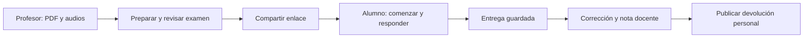

# English Room

**Plataforma web para preparar, tomar y corregir evaluaciones de inglés.**

Un proyecto pensado para que los profesores conviertan sus ejercicios en PDF en exámenes interactivos, reciban las entregas de los alumnos y publiquen notas y devoluciones.

[Ver la aplicación](https://english-room-thiago-1107.soaringfoam1.chatgpt.site/) · [Guía de operación](OPERACION.md)

> Estado: versión funcional en desarrollo, pendiente de prueba piloto con profesores y alumnos. El espacio docente requiere una invitación del colegio. Este repositorio no publica credenciales de demostración ni datos reales.

## Funciones

| Profesores | Alumnos |
| --- | --- |
| Importar PDF con texto seleccionable y revisar los ejercicios | Responder desde computadora o celular |
| Ocultar respuestas y reconocer formatos compatibles | Elegir opciones, marcar casillas y arrastrar palabras |
| Configurar campos cortos o extensos para writing | Escuchar los audios de listening |
| Adjuntar audios y definir un tiempo límite por alumno | Continuar el intento con el mismo plazo al recargar |
| Abrir y cerrar las entregas | Entregar respuestas y guardar un comprobante personal |
| Corregir writing, asignar nota final y escribir devoluciones | Consultar nota y comentarios cuando la profesora los publique |
| Exportar notas CSV, imprimir entregas y descargar/restaurar ZIP | Acceder al examen sin crear una cuenta |

Las cuentas docentes se crean por invitación. Cada profesor tiene su propio espacio con borradores y material persistentes. La administración del colegio gestiona invitaciones, recuperación de acceso y activación de cuentas.

La IA es opcional y está desactivada por defecto para corregir. Con una clave de respuestas, las selecciones y respuestas cortas se comparan en el servidor; el writing queda para revisión docente. Preparar un PDF sin resolver con IA requiere configurar la API y genera consumo.

## Flujo de evaluación



## Tecnologías

- TypeScript, React y componentes accesibles.
- Vinext y Vite, con estructura App Router compatible con Next.js.
- Cloudflare Workers para los endpoints, D1 para los registros y R2 para los audios.
- Drizzle para esquema y migraciones SQLite.
- PDF.js para extraer texto y reconstruir el orden de lectura de los PDF.
- OpenAI Responses API para las funciones opcionales de IA.
- Fflate para respaldos ZIP, Tailwind CSS y Lucide para la interfaz.

## Desarrollo local

Requisitos: **Node.js 24** y **pnpm 11**. El proyecto utiliza Workers y servicios D1/R2 emulados localmente; requiere más que un servidor de archivos estáticos.

```bash
git clone https://github.com/thiagoandres04/english-room.git
cd english-room
pnpm install --frozen-lockfile
cp .env.example .env.local
pnpm build
```

El worker de PDF.js se copia desde la dependencia instalada al ejecutar `dev` o `build`. Se genera localmente y no se duplica en el repositorio.

Aplicar las migraciones a la base **local**, una sola vez y en orden:

```bash
for migration in drizzle/*.sql; do
  node --import ./scripts/sites-env.mjs ./node_modules/wrangler/bin/wrangler.js d1 execute DB --local --config dist/server/wrangler.json --persist-to .wrangler/state --file "$migration"
done
```

Generar los valores privados para configurar un colegio nuevo:

```bash
node scripts/create-school-setup.mjs
```

Copiar `SCHOOL_SETUP_HASH` y `SCHOOL_SETUP_EXPIRES` a `.env.local`, iniciar `pnpm dev` y abrir el enlace privado generado. El enlace permite crear el administrador del colegio; después los profesores ingresan mediante invitaciones. No compartir ni versionar los valores generados.

`OPENAI_API_KEY` es opcional. Sin ella se puede usar un PDF resuelto, preparar los campos manualmente y corregir con la referencia docente o revisar el writing. Las pruebas incluidas simulan las respuestas de IA y no consumen API.

## Comprobaciones

```bash
pnpm test
pnpm check
pnpm build
```

Las pruebas públicas usan datos sintéticos. Cubren reconstrucción de texto del PDF, campos de writing, rangos de audio, búsqueda de entregas, bancos de palabras, selección múltiple de listening y validación de respuestas de IA simuladas.

## Estructura

```text
app/          Interfaz principal y endpoints
components/   Editor, examen del alumno, corrección y administración
lib/          PDF, tipos de ejercicio, evaluación y autenticación
db/           Esquema y acceso a datos
drizzle/      Migraciones de base de datos
scripts/      Desarrollo, comprobaciones y configuración local
public/       Recursos públicos
```

## Alcance y próximos pasos

- El PDF debe contener texto seleccionable: no hay OCR ni conservación de imágenes y diagramas del original.
- El reconocimiento automático cubre formatos compatibles y necesita revisión docente; el marcado manual permite resolver casos no reconocidos.
- El puntaje automático es orientativo. La profesora decide la nota final y cuándo publica la devolución.
- Una instancia está organizada para un colegio. Los alumnos ingresan nombre y curso; no hay padrón ni identidad verificada del alumno.
- El reloj se controla en el servidor. Para conservar cambios hasta el vencimiento hay que mantener la conexión y comprobar el guardado.
- Los respaldos son descargables a pedido; no son un servicio automático programado de recuperación de infraestructura.
- Antes de evaluaciones oficiales quedan pendientes el piloto, la evaluación del alojamiento para la población destinataria y los acuerdos de operación con el colegio.

## Publicación y privacidad

Esta es una copia de código para presentación y revisión. No contiene la base del colegio, exámenes reales, entregas de alumnos, audios privados, claves de API, cookies, contraseñas ni el historial del desarrollo interno.

`.openai/hosting.json` declara los nombres de los servicios locales y no está vinculado a la instancia de producción. Para alojar una copia propia hay que configurar sus servicios y secretos de manera independiente. El servidor requiere un runtime compatible con Workers; GitHub Pages por sí solo no ejecuta esta aplicación.

Las dependencias conservan sus propias licencias. Este repositorio no incorpora una licencia de código abierto para el código de la aplicación.

Los profesores pueden filtrar su biblioteca por año y eliminar sus propios exámenes cerrados, con confirmación y opción de respaldo previo. La eliminación incluye las entregas, correcciones y devoluciones vinculadas.

## Reconocimiento visual opcional

En Preparar ejercicios, **Reconocer con IA** analiza el examen completo, la página actual o una selección de texto completa. Si el PDF original ya no está en memoria, se puede adjuntar sin alterar el borrador. Se envían texto y páginas JPEG a OpenAI Responses API (`gpt-6.1-terra`, `store:false`); hasta 8 páginas, 30.000 caracteres y 60 respuestas por consulta. Muestra una propuesta editable, observaciones y tokens reales antes de aplicarla. Conserva los ejercicios fuera de la región elegida y permite recuperar el borrador anterior. No activa la corrección de entregas con IA. Requiere saldo de API.

`node --experimental-strip-types scripts/check-ai-recognition.mjs` verifica el formato visual, opciones, reemplazo parcial, límites y privacidad con respuestas simuladas, sin consumir saldo.
